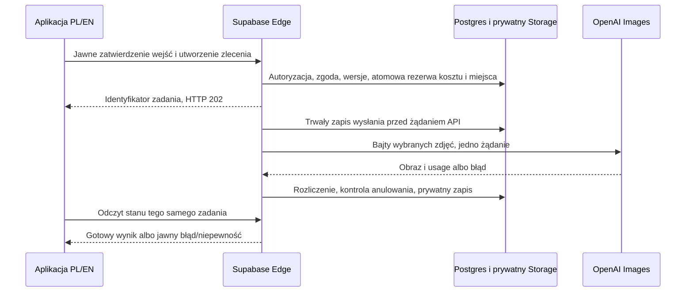

# Plan implementacji Ubranka — V1.6

Data: 2026-10-25. **P3.2 odebrane z ograniczeniami. P3.3: zatwierdzone wyłącznie
planowanie, bez implementacji i nowych płatnych wywołań.** Poniższy plan jest
gotowy do decyzji; żadna z faz A–D nie jest jeszcze zlecona do wykonania.
[Wymagania V1.6](REQUIREMENTS-V1.6.md), [zasady danych AI V1.0](P33-AI-DATA-POLICY-V1.0.md),
[koszty V1.5](COST-PLAN-V1.5.md). Starsze wersje zachowujemy jako historię.

## Rekomendacja i rezultat

Pozostawić Expo/TypeScript, Vercel jako frontend oraz obecny Supabase Free
Frankfurt jako prywatny magazyn, bazę i serwer. Kandydat do generowania:
**OpenAI GPT Image 2.5 Flare, snapshot 2026-09-08**, na podstawie P3.2.
Bez dodatkowego modelu tekstowego, bramki AI i nowego abonamentu.

Docelowy pierwszy przebieg: wybieram profil i okazję → dostaję najwyżej dwa
kompletne zestawy z własnej szafy → wybieram jeden → sprawdzam fotografie
przeznaczone do OpenAI → świadomie uruchamiam jedną wizualizację → widzę
wynik obok oryginałów i mogę go usunąć. Samo przeglądanie nie wywołuje AI.

P3.2 wykazało niski koszt i użyteczność części wyników, ale także zmianę kroju.
Nie zbadało kilku osobnych ubrań ani zdjęć domowych. Dlatego przed prywatnymi
zdjęciami sprawdzamy nowy przepływ na syntetycznych danych. Akceptacja wyników
P3.2 nie oznacza zatwierdzenia nowego dostawcy danych, klucza serwerowego i budżetu.

## Podział wykonania

| Faza | Dostarczony rezultat | Granica |
| --- | --- | --- |
| **P3.3A — rekomendowana teraz do zatwierdzenia** | Profil sylwetki, własne zestawy, zapis/oceny, ekrany wizualizacji, trwałe zlecenia i testy kontroli danych/kosztów. Lokalny/CI adapter syntetyczny; na hostingu płatne AI wyłączone. Testy wyłącznie syntetyczne, podgląd main. | Bez klucza OpenAI na serwerze, płatnych wywołań i przesyłania zdjęć do OpenAI. |
| **P3.3B — późniejsza osobna zgoda** | Do 6 wywołań / 10 PLN łącznie na syntetycznych wejściach, przez rzeczywisty worker Supabase. Raport jakości, kosztu i czasu. | Wlicza przygotowanie/błędy, brak retry. Nie zużywa starej zgody P3.2 i nie uruchamia C. |
| **P3.3C — późniejsza osobna zgoda po B** | Pilotaż dwóch kont na 30 dni, prywatne zdjęcia wyłącznie po zgodzie każdego użytkownika, 25 PLN AI łącznie i proponowane limity V1.5. | Koniec po terminie/limicie; bez automatycznego przedłużenia, nowych abonamentów i nieuzgodnionych doładowań. |
| **P3.3D — zachowane wymaganie na później** | Rozpoznawanie zdjęć z możliwością korekty. | Wymaga osobnego modelu, testu, zasad danych i budżetu. Ręczne opisy w A nie zamykają tego wymagania. |

Plan świadomie rozwija dawny ogólny P3.3 z V1.4. Pełny etap obejmujący rozpoznawanie
nie zostanie oznaczony jako skończony po samym A, B lub C. Nie obejmujemy zakupów
ani sklepów P4. Kolejne fazy nie uruchamiają się tylko dlatego, że A przeszło testy.

## P3.3A — kolejność prac po przyszłej zgodzie

1. **Model i zgodność danych.** Oddzielić profil sylwetki od profili stylu.
   Dodać opcjonalne ręczne rozmiary/system rozmiarów, wzrost i obwody
   klatki/talii/bioder w cm, bez wyliczania ich ze zdjęcia. Istniejące profile
   działają z brakującymi danymi. Nowe prywatne tabele/metadane nie dotykają
   klucza demo `ubranka:p2:v1`; wersjonowanie i konflikt dwóch urządzeń pozostają.
2. **Zdjęcie sylwetki.** Jedna aktualna kopia/konto, prywatna, podgląd przed
   zapisem, usunięcie metadanych, wymiana/usuwanie według polityki AI. Fotografia
   ubrania „na sobie” z P3.1 nie staje się automatycznie zdjęciem sylwetki.
   Zapis do Supabase wymaga osobnego wyjaśnienia; nie jest wysłaniem do OpenAI.
3. **Dobór z własnej szafy.** Na prośbę, maksymalnie dwa komplety: góra/dół/buty
   albo sukienka/buty, najwyżej trzy rzeczy. Filtr okazji, potem reguły zgodności
   kategorii/kolorów, preferencje i opinie per profil. Nie udajemy rozpoznawania
   ani dokładnego dopasowania do ciała bez danych o kroju/rozmiarach samych rzeczy.
   Ręczna zamiana, brak kompletu opisany wprost, 0 PLN nowego zakupu.
4. **Przepływ wizualizacji PL/EN.** Wybrany zestaw, dokładne miniatury, zgoda AI,
   rezerwa, przycisk, stany pracy, historia, ocena błędu, pobranie i usunięcie.
   W A przycisk płatnej generacji jest niedostępny. Osobny „Zobacz przykład”
   korzysta z P3.2, z etykietą „Przykład działania — nie jest wizualizacją Twoich
   zdjęć”; nie wysyła wybranych zdjęć i nie wpisuje fikcyjnego kosztu jako wydatku.
5. **Bezpieczny backend.** Przygotować schemat zleceń/zgód/rezerw, adapter
   dostawcy, wyłączenie globalne i testy awarii. Brak sekretu lub tryb OFF oznacza
   odmowę na serwerze. Adapter testowy tylko lokalnie/CI, nigdy cichy fallback
   z błędu produkcyjnego na obraz przykładowy.
6. **Regresje i podgląd.** Testy poniżej, jawny raport A, publikacja zatwierdzonego
   zakresu dev/main. Zatrzymanie przed dodaniem klucza i pierwszą płatną próbą B.

## Proponowana architektura generowania

Osobna funkcja `visualization-worker`; nie doklejać generowania do `wardrobe-cleanup`
ani do obecnego klienta HTTP z timeoutem 15 s. Supabase Free ma limit 150 s czasu
workera, 2 s CPU i 256 MB pamięci; `waitUntil` nie daje trwałej kolejki ani dłuższego
limitu. Proponujemy 90 s timeoutu OpenAI i 120 s całego przebiegu z pobraniem/zapisem.
To kompromis, nie gwarancja: złożona generacja może trwać około dwóch minut.
[Limity](https://supabase.com/docs/guides/functions/limits),
[background tasks](https://supabase.com/docs/guides/functions/background-tasks),
[latencja generacji](https://developers.openai.com/api/docs/guides/image-generation#limitations).

Trwałość zapewnia baza: odświeżenie/utrata sieci nie generuje ponownie. Klient
tworzy klucz idempotencji **przed pierwszym POST** i zachowuje minimalny uchwyt
operacji do rozstrzygnięcia, oddzielnie od stanu demo i bez kopii zdjęć/profilu.
Serwer wiąże ten klucz z właścicielem i fingerprintem wejść; utrata odpowiedzi
HTTP 202 nie pozwala wygenerować nowego klucza jako automatycznego ponowienia.
Po restarcie bez lokalnego uchwytu najpierw odczyt zleceń właściciela z serwera,
zamiast automatycznego ponownego wysłania. Stan
`reserved → sent → succeeded/failed/outcome_unknown`; przed wysłaniem możliwe
`cancelled/expired`. Serwer tworzy intencję z krótkim terminem ważności (15 min),
UUID, właścicielem, fingerprintem zdjęć/wersji, modelem i wersją zgody. Powtórzenie
tego ID zwraca jego stan, inny payload daje konflikt. Nowe kliknięcie nie omija
globalnego limitu jednej aktywnej generacji i blokad konta/budżetu.

Przejście `reserved → sent` jest atomowe; tylko zwycięski worker wysyła żądanie.
Stan `sent` powstaje przed połączeniem z OpenAI. Nie ma gwarancji exactly-once
po stronie dostawcy: awaria po wysłaniu może zostawić koszt bez obrazu. Po `sent`
nigdy automatycznie nie wysyłamy ponownie; nawet niepewność między zapisem stanu
a siecią jest traktowana konserwatywnie. UI pokazuje „Nie udało się potwierdzić
wyniku i kosztu”; odczyt stanu nie ponawia generacji. Watchdog/cleanup wykrywa
zaległość, ale nie uruchamia kolejnego płatnego żądania.

Nie obiecujemy zatrzymania kosztu po wysłaniu. Zlecenie po usunięciu wejść/konta
może zostać rozliczone, lecz wynik nie staje się widoczny. Przed zapisem tworzony
jest manifest obiektów; przed publikacją ponowna kontrola konta, zgody i wersji.
Istniejąca dzierżawa 5 min i kontrolowane czyszczenie muszą uwzględniać spóźnione
pliki. Rozszerzyć także `deleteAccount`, `wardrobe_prepare_auth_delete` i eksport:
nie można usunąć Auth ani metadanych przed zebraniem wszystkich ścieżek do sprzątania.

Obecny cron co 10 min może sprzątać AI i oznaczać porzucone zadania, bez generowania.
Zachować jego ograniczony czas i sprawiedliwą obsługę szafy/AI; nie obiecywać
natychmiastowego końca operacji w razie wstrzymania Free. Odczyt wyników przez
świeżo autoryzowany POST i `no-store`, bez przywracania bezpośredniego Storage SELECT.
RLS i serwer sprawdzają właściciela oraz aktywność, także przy ręcznym RPC i starym JWT.
Rezerwy i rozliczenia są niedostępne do dowolnego zapisu klienta.

## Kontrakt obrazów, miejsca i środowisk

- Zdjęcie osoby i maks. trzy zdjęcia rzeczy; kopie maks. 1024×1536, bez rozciągania
  sylwetki/ubrania. Dopełnienie neutralnym tłem, kontrola orientacji i podgląd.
  Limit pojedynczego wejścia 1 MB, prompt aplikacji maks. 2500 znaków. Bez
  publicznych URL, Files API i przesyłania innych danych profilu.
- Flare snapshot z P3.2, `n=1`, `medium`, `1024x1536`, PNG/opaque, moderacja auto.
  Żadnych dowolnych parametrów od klienta, „auto” jakości ani innego modelu po błędzie.
  Zdjęcia wielu rzeczy są obsługiwane przez API, co nie dowodzi ich wierności:
  [kontrakt Images edits](https://developers.openai.com/api/reference/resources/images/methods/edit).
- Przed wywołaniem rezerwować 8 MB na wynik + 100 kB miniatury oraz koszty.
  Sprawdzić realny CPU/RAM dekodowania i miniatur w A/B. Wynik przekraczający
  limit nie jest przechowywany jako sukces, ale koszt pozostaje rozliczony.
  30 wyników / 100 MB to dwa równoległe ograniczenia, nie gwarancja miejsca na
  30 plików po 8 MB. Wyniki i zdjęcie sylwetki mieszczą się w limicie konta 250 MB.
- Dev i main zachowują obecny wspólny Supabase. Nie tworzymy drugiego płatnego
  środowiska. Local/CI używają syntetycznych danych. W B wyłącznie kontrolowane
  syntetyczne rekordy i zatwierdzone hashe wejść; inne wywołania nadal zablokowane.
  W C serwerowa lista dopuszczonych kont/wersji klienta i globalny budżet obejmują
  oba adresy. CORS pomaga, ale nie zastępuje autoryzacji ani limitów.
- Lokalnego klucza P3.2 nie przenosimy. Ewentualny klucz serwerowy o ograniczonych
  prawach powstaje po osobnej zgodzie na B/C i trafia tylko do sekretów Edge,
  bez kodu, Git, EXPO_PUBLIC, przeglądarki lub zwykłych Preview. Sprawdzić ważność
  i uprawnienia, nie zakładać ich na podstawie poprzedniego klucza.

Jeśli Free nie zapewnia marginesu czasu/CPU w B, zatrzymać aktywację i przedstawić
zmianę architektury. Vercel Node/Fluid jest możliwą alternatywą, ale wymaga
weryfikacji bieżącego planu/kosztu oraz dopisania odbiorcy zdjęć do polityki;
nie wybieramy go automatycznie ani nie kupujemy planu.
[Czas funkcji Vercel](https://vercel.com/docs/functions/configuring-functions/duration).

## Weryfikacja i odbiór

**A, bez wywołań modeli:** wymagane `npm run check`, `npm test`, testy backendu
i Deno, prywatne E2E oraz `build:all` po zmianach wspólnego UI. Testy pokrywają:
RLS A/B, stary token po usunięciu, bezpośredni RPC, zduplikowane kliknięcie,
dwa konta przy ostatniej rezerwie, inny payload z tym samym ID, utratę 202
(pierwsza generacja już gotowa, ten sam klucz zwraca ją bez drugiej opłaty), crash przed/po
`sent`, brak usage, granicę miesiąca/końca pilotażu, wycofanie zgody, usunięcie
wejścia/konta w locie, spóźniony zapis, pełny Storage i eksport. Asercje sieciowe
potwierdzają zero żądań do dostawcy w trybie OFF. Nie testujemy przypadkiem na
prywatnych danych użytkowników. Migracje najpierw lokalnie i na syntetycznych
rekordach; wdrożenie w istniejącej chmurze dopiero w zatwierdzonym zakresie A.

**B, po nowej zgodzie:** sześć jawnych przypadków, po jednym wywołaniu Flare:
kobieta i mężczyzna × codzienny/elegancki/gość weselny. Wejścia przygotowane
lokalnie z istniejących materiałów syntetycznych, z oddzielnymi zdjęciami rzeczy;
bez dodatkowych płatnych generacji. W obu płciach przynajmniej jeden przypadek
z trzema rzeczami (4 obrazy łącznie). Uczciwie opisać ewentualne wycinki/pozostałości
modela w zdjęciu rzeczy; nie przedstawiać ich jako testu prawdziwego flat-lay.
Hosted Edge, rzeczywisty zapis i usuwanie, tokeny, czas pobrania/generacji/zapisu,
CPU/RAM jeśli platforma je udostępnia, rozmiary plików i pełne koszty.
Limit 6/10 PLN obejmuje wszystkie płatne żądania i kończy próbę bez retry.
Próg proponowany ≥5/6 technicznie użytecznych (skala P3.2), następnie odbiór
Kasi/Aleksego; każda podmiana osoby, pominięcie rzeczy lub istotna zmiana kroju
jest błędem krytycznym. Brak danych telemetrycznych opisać, nie wymyślać dowodów SLA.

**C, po odbiorze B i nowej zgodzie:** odczyt ustawień usług/finansowania, osobista
akceptacja danych AI, kontrola klucza i limitów. Mały test własnego zdjęcia przez
każdą osobę z jej konta; już wliczony w budżet i liczniki C. Przegląd użyteczności,
kosztów i błędów po okresie; brak samoczynnego zwiększania wolumenu. WWW sprawdzić
na Safari iPhone oraz Chrome Android; bez udawania, że to test natywnego builda.
Logowanie Kasi z P3.1 nadal trzeba faktycznie potwierdzić przed jej testem C.

## Decyzja do podjęcia teraz

Rekomenduję zatwierdzić **tylko P3.3A** z tego dokumentu: implementację fundamentu,
prywatne zestawy i podgląd, testy syntetyczne, bez płatnego AI, klucza AI w chmurze
i nowych abonamentów. Po odbiorze A przedstawimy konkretną zgodę B, a po jego
raporcie zgodę C wraz z aktualnym finansowaniem i zasadami zdjęć. Nie jest
potrzebne ponowne zatwierdzanie odebranego P3.2.
