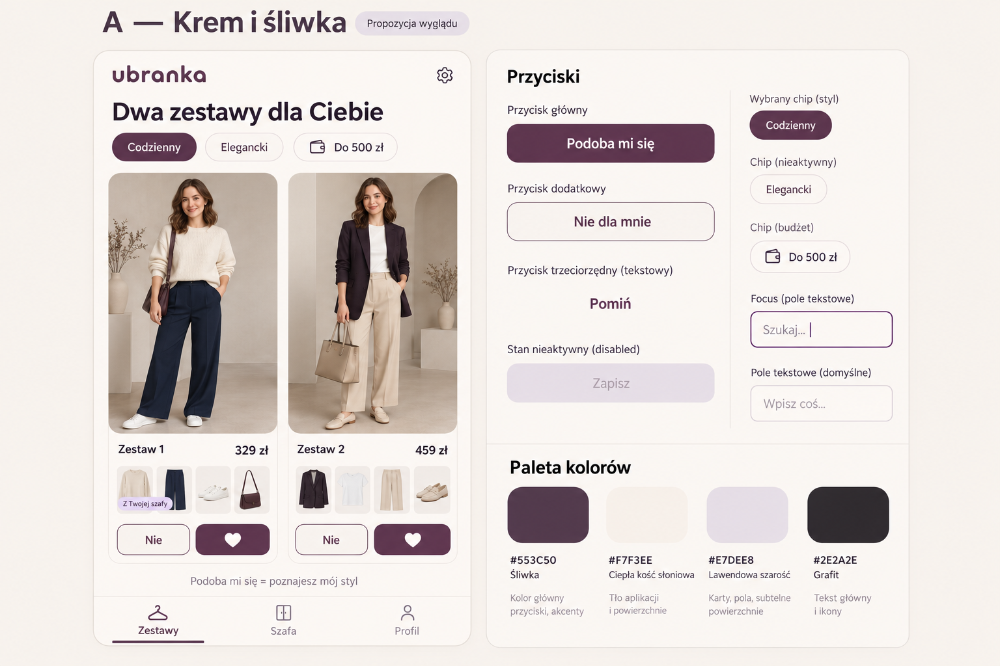
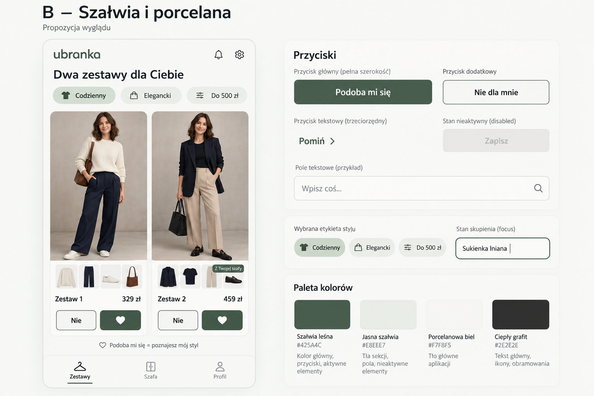
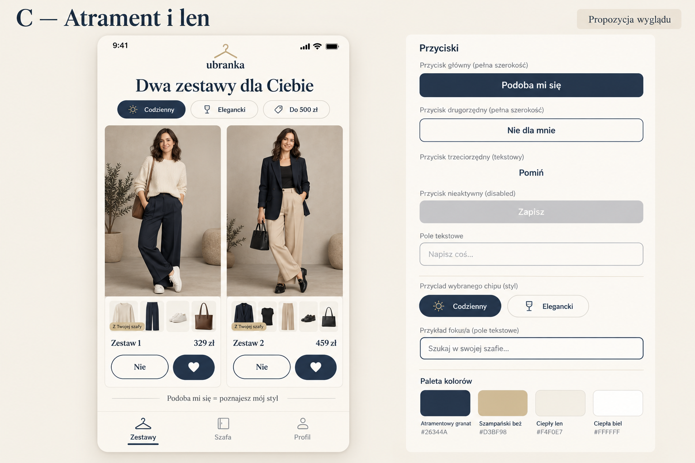

# Kierunki wizualne Ubranka — V1.1

Data: 2026-10-24. Status: trzy propozycje do wyboru; żadna nie została zatwierdzona.
Odpowiadają na punkt 19 wywiadu: spokojny wygląd, czytelne przyciski i mało decyzji.

## Porównanie

| Kierunek | Charakter | Kolory bazowe | Rekomendacja |
| --- | --- | --- | --- |
| A — Krem i śliwka | Ciepły, przyjazny, miękkie karty i zaokrąglone przyciski. | Tło `#F7F3EE`, śliwka `#553C50`. | Dobry, jeśli ważne jest przytulne wrażenie i ciągłość obecnego ekranu startowego. |
| B — Szałwia i porcelana | Spokojny, prosty i neutralny; oszczędne dekoracje. | Tło `#F7F8F5`, szałwia `#425A4C`. | Rekomendowany punkt wyjścia dla wspólnej aplikacji dla kobiet i mężczyzn. |
| C — Atrament i len | Elegancki; nagłówki inspirowane magazynem modowym. | Tło `#F4F0E7`, granat `#26344A`, akcent `#D3BF98`. | Dobry, jeśli przeważyć ma wrażenie elegancji. |

Rekomendacja B jest oceną projektową, nie wynikiem testów użytkowników.
Można wskazać jeden kierunek lub połączyć konkretne cechy; bez wyboru nie zmieniamy aplikacji.

## A — Krem i śliwka

## B — Szałwia i porcelana

## C — Atrament i len

## Zakres i ograniczenia makiet

- Każda plansza pokazuje wybór dwóch zestawów oraz próbki przycisków, pól i palety.
  Układ dwóch pełnych zestawów jest propozycją; tryb ekonomiczny/markowy wymaga Q21.
- Osoby, ubrania i ceny są ilustracją wygenerowaną na potrzeby projektu. Nie są
  ofertami sklepów, zdjęciami użytkowników ani wynikiem działającej przymierzalni.
- Plansze pokazują przykład kobiecy; zakres produktu obejmuje także mężczyzn.
  Kolejny prototyp powinien sprawdzić oba przypadki.
- Kwota 500 zł jest przykładem. Sposób liczenia wartości własnych rzeczy i dostaw
  wymaga Q22; cen na planszach nie należy traktować jako finalnej kalkulacji.
- Oceniono wizualnie trzy obrazy: tekst jest czytelny, widoczne są dwie propozycje,
  osobne oceny i stany komponentów. Nie wykonano jeszcze testów dostępności ani
  dopasowania interaktywnego układu do ekranu 360–390 px.
- B zawiera dekoracyjną ikonę dzwonka; nie ustanawia ona funkcji powiadomień.
  Propozycje mają powstawać na prośbę użytkownika. W implementacji usunąć zbędną ikonę.
- C ma mocniej zaokrąglone przyciski niż w poleceniu i ozdobny pasek telefonu.
  To koncepcja charakteru, a nie dokładna specyfikacja odstępów i kształtów.
- Podczas implementacji zapis „Podoba mi się = poznajesz mój styl” warto skrócić
  do jasnego komunikatu „Polubienia pomagają nam poznać Twój styl”.
- Przyciski, pola, tekst i ikony zostaną wykonane jako prawdziwe komponenty
  React Native/Expo. Nie wklejamy całej makiety ani obrazków przycisków zamiast UI.
  Kontrast, powiększanie tekstu, etykiety czytnika, klawiatura i cele dotykowe
  podlegają sprawdzeniu w działającym prototypie.

## Sposób wykonania

Użyto wbudowanego narzędzia imagegen, bez wywołań z kluczem API Ubranka.
Interfejs narzędzia nie udostępnia wyboru konkretnej wersji modelu, więc nie
przypisujemy obrazom niepotwierdzonej wersji „Images 2.5”.
Aktualna dokumentacja OpenAI opisuje [GPT Image 2.5 Flare](https://developers.openai.com/api/docs/models/gpt-image-2.5-flare)
i [generowanie obrazów](https://developers.openai.com/api/docs/guides/image-generation);
wybór API do przyszłej przymiarki jest osobną decyzją z próbą jakości i kosztu.

Zachowano [pełne prompty trzech generacji](PROMPTS-V1.1.md) oraz trzy pliki PNG
1536 × 1024 w tym katalogu. Są to materiały projektowe; nie dodano ich do zasobów
produkcyjnego ekranu aplikacji. Generowanie makiet nie uruchamia rozliczeń API projektu.
